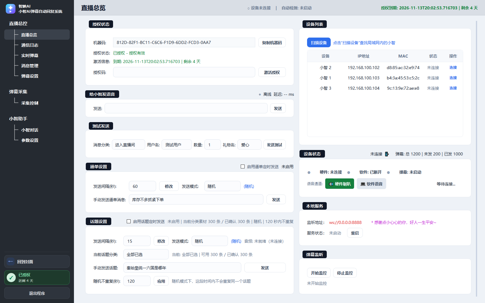
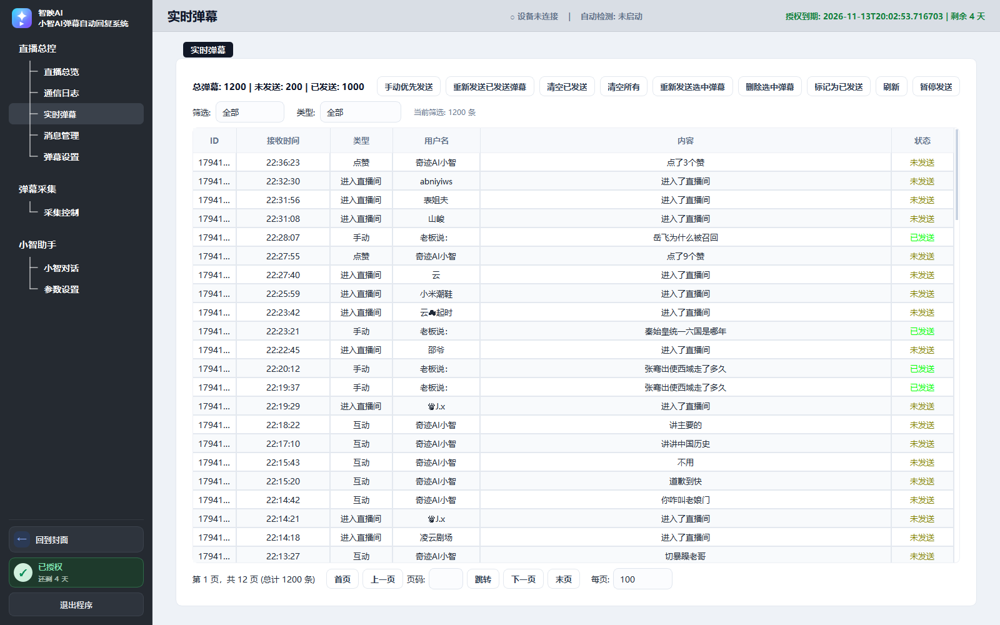
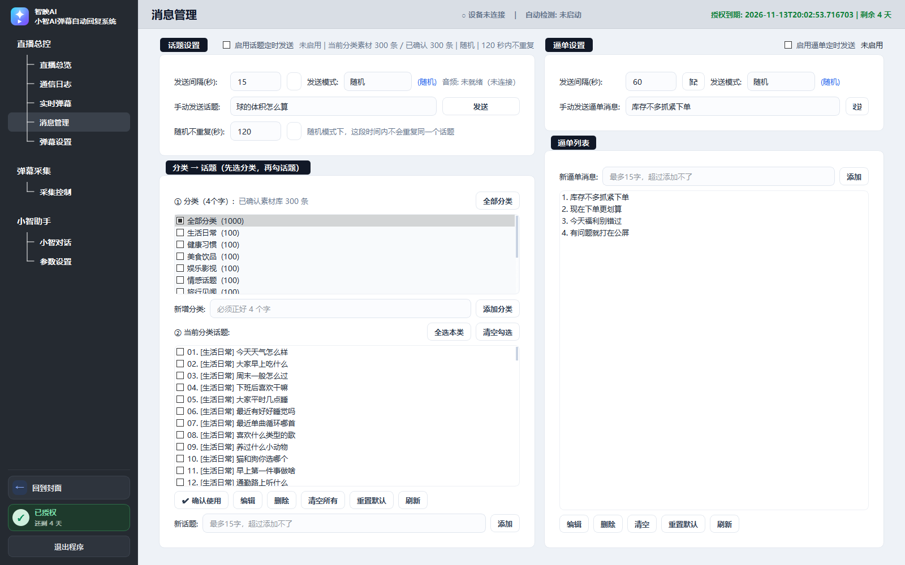
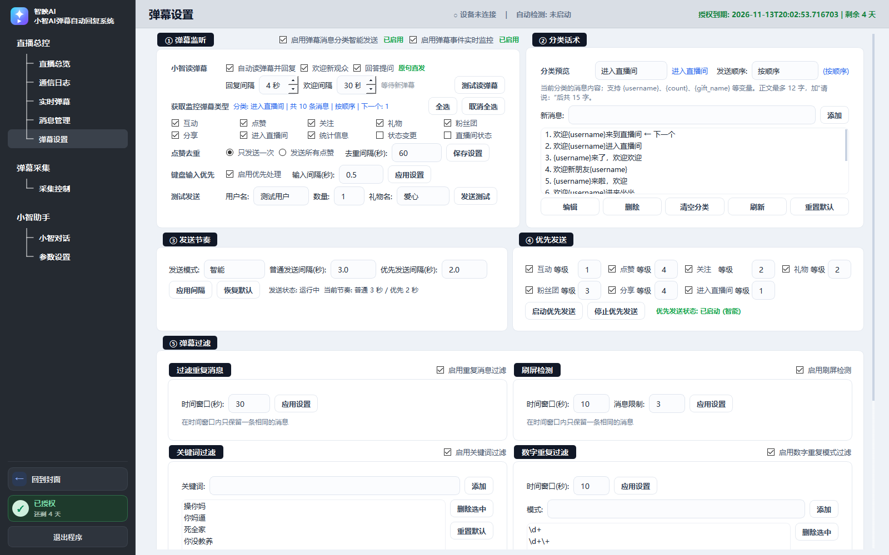
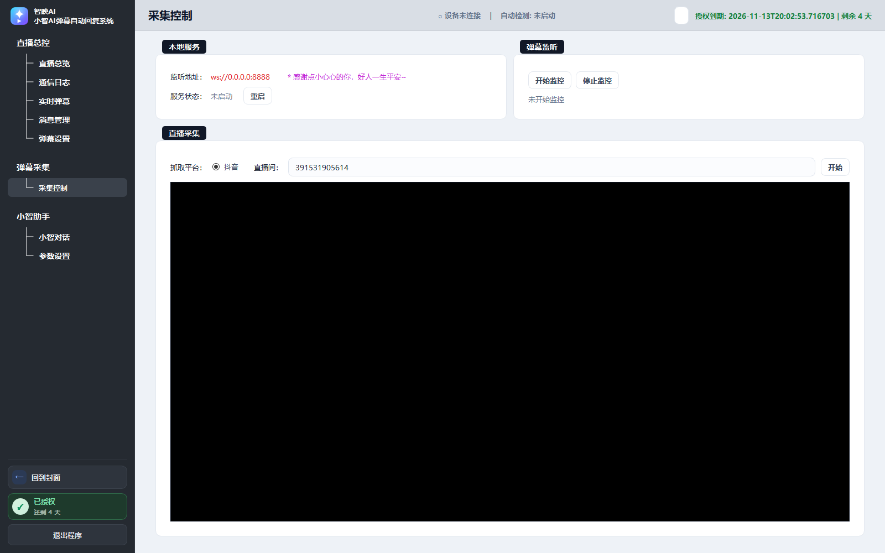
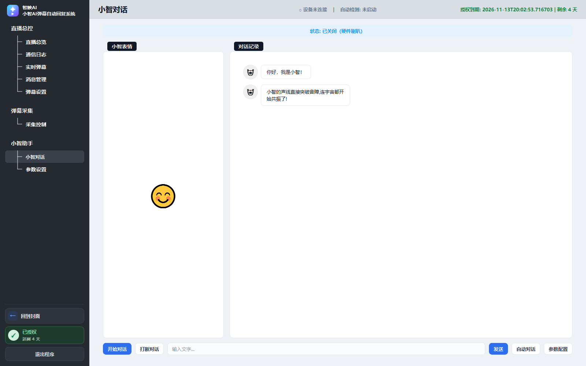
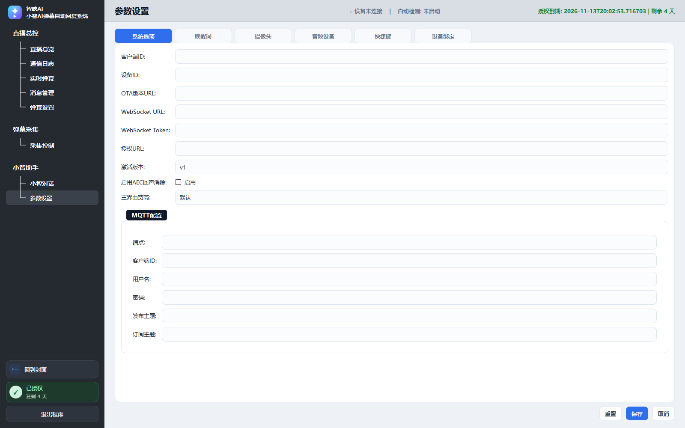
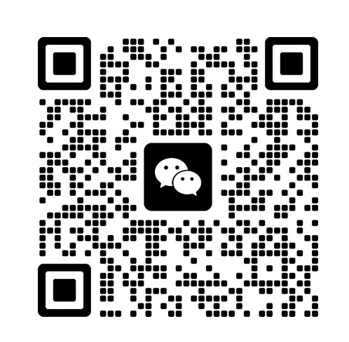

# 智映AI · 小智AI弹幕自动回复系统

把抖音直播间弹幕接入「小智 AI」，实现弹幕监听、分类筛选、优先级排队、AI 回复与语音播报的 Windows 桌面工具。

[](https://www.python.org/)
[](https://pypi.org/project/PyQt5/)
[](LICENSE)

> 开源仓库：<https://github.com/wangjianlin2026/zhiying-danmu>
>
> 安装包下载：<https://github.com/wangjianlin2026/zhiying-danmu/releases/latest>



## 功能概览

- **直播弹幕采集**：支持抖音直播间链接/房间号采集，实时接收弹幕、进场、点赞、礼物、关注等事件。
- **弹幕分类与过滤**：分类话术、关键词过滤、重复弹幕去重、数字/刷屏过滤、优先级排队。
- **发送节奏控制**：普通弹幕、优先弹幕、定时话题、定时逼单分别控制间隔，避免刷屏。
- **小智 AI 接入**：支持软件小智 WebSocket 服务与硬件小智设备，弹幕交给 AI 回答并语音播报。
- **AI 对话与知识库**：内置小智对话页、产品知识库、欢迎语、问答开关与朗读开关。
- **硬件参数配置**：MQTT、唤醒词、模型、摄像头、视觉语言模型、音频设备、快捷键等参数集中配置。
- **通讯日志**：收到的每条事件、发送结果、连接状态都有日志，方便排查问题。
- **授权管理**：按机器码生成授权码，支持永久/限时授权与授权状态查询。
- **完整使用手册**：随仓库提供 279 页 Word/PDF 使用手册，覆盖每个页面和操作步骤。

## 界面截图

### 直播总览


### 实时弹幕



### 消息管理



### 弹幕设置



### 采集控制



### 小智对话



### 参数设置



## 快速开始

### 方式一：安装版（推荐给普通用户）

1. 打开 [Releases](https://github.com/wangjianlin2026/zhiying-danmu/releases/latest) 下载最新安装包。
2. 双击安装，默认安装到当前用户目录，无需管理员权限。
3. 启动后按使用手册完成设备连接、弹幕采集和授权激活。

安装版会同时安装使用手册，并在开始菜单创建「使用手册」快捷方式。

### 方式二：源码运行（开发者）

环境要求：Windows 10/11 x64、Python 3.12。

```powershell
python -m pip install -r requirements.txt
python main.py
```

也可以直接双击：

- `安装依赖.bat`：首次运行前安装 Python 依赖。
- `启动源码版.bat`：无控制台启动。
- `调试启动.bat`：带控制台启动，方便查看报错。

运行数据保存在 `data\`，首次启动会自动补齐默认配置。

## 使用手册

- [Word 版](docs/manual/小智AI弹幕自动回复系统_使用手册_v1.docx)
- [PDF 版](docs/manual/小智AI弹幕自动回复系统_使用手册_v1.pdf)

手册包含安装、授权、设备连接、弹幕采集、分类话术、发送节奏、AI 参数、音频/摄像头配置、
常见问题等完整章节与界面截图。

## 目录结构

```text
.
├─ main.py                 # 程序入口与主窗口
├─ cover.py                # 封面、授权与联系商家
├─ pages_*.py              # 各功能页面
├─ dialogs.py              # 通用对话框
├─ data_access.py          # 本地数据读写
├─ theme.py / widgets.py   # 主题与自定义控件
├─ services/               # 弹幕、AI、硬件、授权、音频等服务
├─ assets/                 # Logo 与联系商家二维码
├─ data/                   # 默认配置（运行后会产生日志与状态文件）
└─ docs/                   # 使用手册与界面截图
```

## 环境与依赖

主要依赖：

- PyQt5 5.15
- requests / websockets / websocket-client
- OpenCV / NumPy / Pillow
- sounddevice / pywin32 / comtypes / WMI
- PyExecJS / mini-racer / protobuf

完整版本见 [`requirements.txt`](requirements.txt)。

> 音频转码（opus/soxr）依赖外部 `小智-1.0.0-x86_64` 目录；未放置该目录时，
> 主程序与弹幕功能仍可启动，语音相关能力会按页面提示降级。

## 打包

项目可使用 PyInstaller 打包为 Windows 桌面程序。打包时需把 `assets/` 和
`services/douyin_live/*.js` 作为数据文件一并带入，安装包可使用 NSIS 制作。

## 授权与联系商家

发行版按机器码授权。打开封面授权页，点击「联系商家」可扫码添加商家，
将本机机器码发给商家开通授权。



## 第三方与许可

本项目采用 **GNU Affero General Public License v3.0（AGPL-3.0）** 开源。
其中抖音直播采集相关代码参考/衍生自
[`saermart/DouyinLiveWebFetcher`](https://github.com/saermart/DouyinLiveWebFetcher)
（AGPL-3.0），因此本项目整体按 AGPL-3.0 发布。其它第三方依赖保留各自许可证，
详见 [`NOTICE.md`](NOTICE.md)。

## 免责声明

本项目仅用于学习、研究与合法的直播互动场景。使用者应遵守抖音平台规则及所在地区法律法规，
不得用于刷屏、骚扰、欺诈、侵权或其它违法用途。因使用本项目产生的内容与后果由使用者自行承担。

